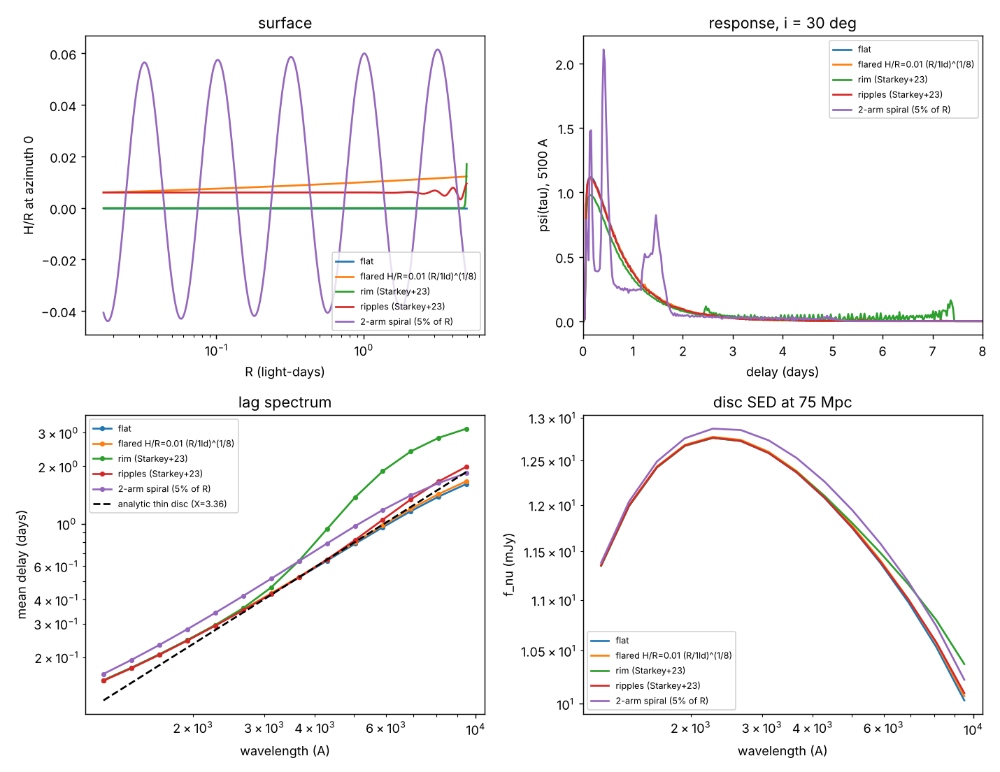
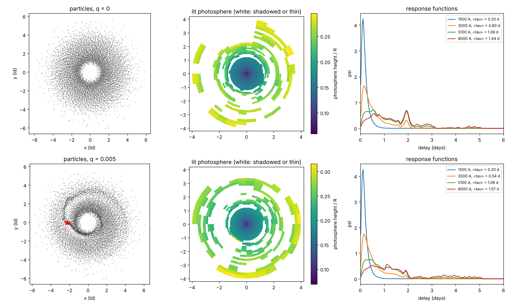

# discsim

N-body / SPH simulations of AGN accretion discs and the environment around the
black hole, and what they do to **continuum reverberation**: response functions,
lag spectra, disc SEDs and mock light curves that
[pycream2](https://github.com/drds1/pycream2) can fit.

The motivation is the **disc-size problem**. Continuum lags are 2–5× longer than
a thin disc of the AGN's luminosity allows (see
[`docs/literature_review.md`](docs/literature_review.md)). Many proposed fixes
are about *structure*: rims, warps, puffed-up outer discs, embedded stars and
compact objects, binaries. Structure comes from dynamics, so this repo
simulates the dynamics and then asks what the light echo looks like.



*Same black hole, accretion rate and lamppost; only the surface shape changes.
A Starkey et al. (2023) rim lengthens the 5100 Å lag ×1.8 while the disc's
flux changes by 1%: the kind of lag-without-light boost the disc-size problem
needs.*



*`scripts/embedded_body.py` (8000 particles, 1.5 orbits of the body). The body
drives a clear spiral wake. At this resolution, though, the photosphere and its
shadows are dominated by particle noise, so the ~10% lag differences between the
two runs are not yet significant. The pipeline works; the science needs
10^5–10^6 particles and tens of orbits.*

## Layout

```
discsim/
  units.py              code units (G = M_BH = 1, light-days) <-> cgs
  gravity.py            central BH (Newton / Paczynski-Wiita, Lense-Thirring spin), massive bodies
  sph.py                minimal vectorised SPH: cubic spline, locally isothermal, Monaghan viscosity
  initial_conditions.py thin/warped discs, rings, a Plummer nuclear star cluster
  simulation.py         KDK leapfrog, accretion, snapshots
  surface.py            particles or analytic H(R, phi) -> reprocessing surface (incl. photosphere for kappa)
  reverb.py             lamppost irradiation with self-shadowing, T(R, phi), response functions, SED
  lightcurves.py        DRW driver, echoes, mock campaigns in pycream2's text format
  pipeline.py           snapshot -> surface -> responses in one call
scripts/
  geometry_responses.py analytic surfaces compared (figure above)
  embedded_body.py      SPH disc +/- an embedded massive body -> photosphere -> lags
  mock_campaign.py      simulated disc -> light curves + a ready-to-run pycream2 fit command
docs/
  literature_review.md  open problems, candidate explanations, what needs to happen
  roadmap.md            experiments E1-E7 and planned code
tests/                  physics checks (see below)
```

## Install

```bash
cd agn-disc-sim
python -m venv .venv && source .venv/bin/activate
pip install -e ".[dev]"
pytest
```

Only numpy, scipy and matplotlib are needed. `.[nbody]` adds REBOUND and
`.[phantom]` adds sarracen, for the production back ends on the roadmap.

## Quick start

```python
import numpy as np
from discsim import DiscPhysics, DiscSurface, Observer, irradiate, response_functions, starkey2023

phys = DiscPhysics(m_bh=5e7, mdot=0.05, l_lamppost=3e43, h_lamppost_rg=10)
rim = DiscSurface.from_function(starkey2023(height=0.15, r_ref=5.0, beta=100.0), phys.r_in_ld, 5.0)
rs = response_functions(irradiate(rim, phys), Observer(inclination_deg=30), [2000, 5100, 8000])
print(rs.mean_lag(), rs.lag_slope())
```

From a simulation:

```python
from discsim import *
from discsim.pipeline import snapshot_responses

pos, vel, m = thin_disc(8000, r_in=1, r_out=4, aspect_ratio=0.05, disc_mass=1e-4)
bodies = MassiveBodies.central()
bodies.add_circular(2.2, 5e-3, softening=0.1)          # an embedded IMBH / star cluster
sim = Simulation(bodies, pos, vel, m, gas=SPHGas(SPHSettings(aspect_ratio=0.05)), r_accrete=0.8)
snap = sim.run(t_end=30.0)[-1]

units = Units(5e7)                                     # 1 code length = 1 light-day
surf, disc, rs = snapshot_responses(snap, units, DiscPhysics(m_bh=5e7), Observer(30), [1500, 5100],
                                    r_in_ld=1, r_out_ld=4, surface_kw=dict(kappa=0.4, n_r=40, n_phi=48))
```

Then make a mock campaign and fit it with pycream2:

```bash
python scripts/mock_campaign.py --geometry rim --out outputs/mock_rim
cd ../echofit && sh ../agn-disc-sim/outputs/mock_rim/fit_with_pycream2.sh
```

## Units and timescales

Code units are G = M_BH = 1 with the length unit in light-days (`Units`). For
10^8 M_⊙: r_g = 0.0057 ld, the time unit is 13.2 days, an orbit at 1 ld takes 83
days and at 5 ld 2.5 years. Light-travel delays (days) are much shorter than
dynamical times everywhere the UV/optical comes from, so reverberation is
computed on frozen snapshots.

## What the physics checks cover

- two-body energy conserved to 1e-6 over 20 orbits; circular orbits stay circular;
- Lense–Thirring nodal precession at the analytic rate `2GJ/(c^2 r^3)`, prograde (3%);
- Paczynski–Wiita force law;
- SPH kernel normalisation, exact momentum conservation, vertical hydrostatic
  balance of the initial disc;
- surface extraction recovers a Gaussian disc's scale height; gaps become
  optically thin holes in the photosphere;
- a flat disc's response is causal and normalised, its lag goes as λ^(4/3), its
  mean lag matches the analytic response-weighted radius (X = 3.36) to 6%, and
  only its lamppost-height term depends on inclination;
- a wall casts a shadow; a Starkey et al. (2023) rim lengthens red lags ≥1.5× and
  far-UV lags <15%;
- echoes of a delta response are shifted drivers; DRW variance.

## Limitations (read before trusting results)

- The SPH is a readable prototype: shared time step, ~0.2 s per step at 6000
  particles. At that resolution the smoothing length exceeds the scale height,
  so vertical structure is under-resolved. Science runs need ~10^6 particles,
  so use Phantom and feed its dumps into `surface`/`reverb` (roadmap).
- No disc self-gravity and no gas back-reaction on bodies yet.
- Reverberation: blackbody emission, linear response, no line-of-sight
  occultation, no relativistic effects, upper surface only.
- The particle "photosphere" assumes each cell's gas is Gaussian in z.

## Citing

The reprocessing model follows Starkey, Horne & Villforth (2016, MNRAS 456,
1960) and the rimmed/rippled discs Starkey, Huang, Horne & Lin (2023, MNRAS 519,
2754).
