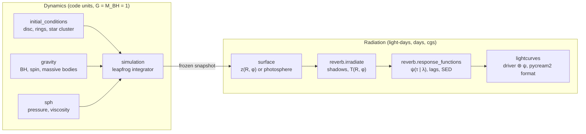
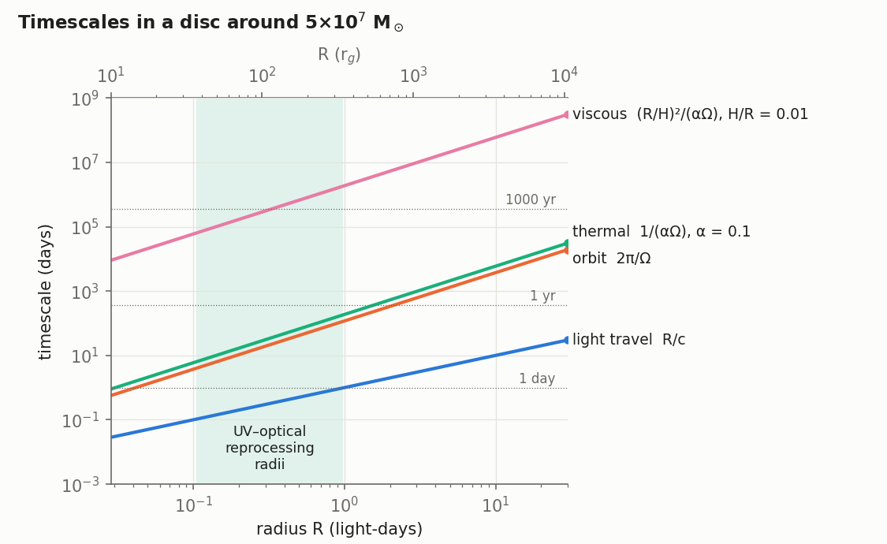
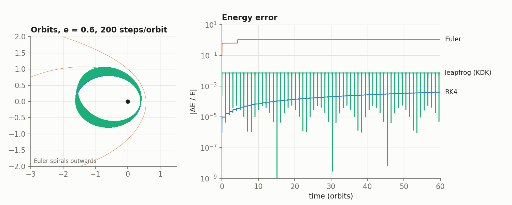
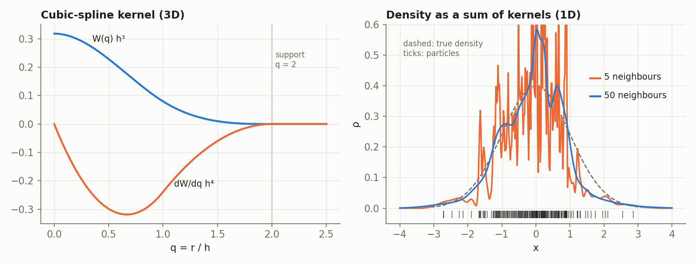
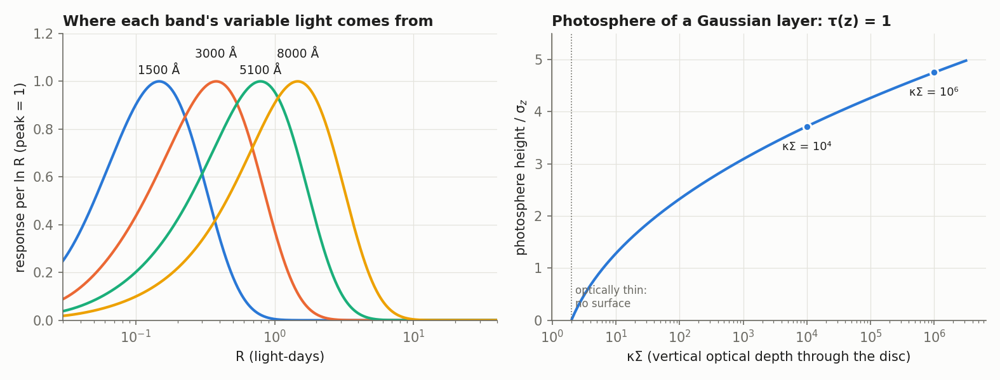
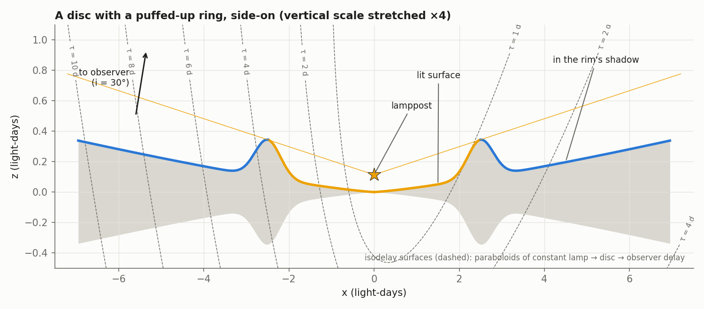

# How the physics is simulated

This note explains what `discsim` actually computes, from the equations of
motion of a single particle up to a mock light curve, and why each
approximation is there. It is written for someone who knows what an accretion
disc and a reverberation lag are, but has not written an N-body or SPH code.

Every section names the module that implements it, so the equations can be
checked against the code. The figures are made by
[`scripts/physics_figures.py`](../scripts/physics_figures.py).

## 1. Two layers, and why they can be separated

There are two very different clocks in an AGN disc:

- **light-travel time**, $R/c$, which sets reverberation delays (hours to days);
- **dynamical times**: the orbital period $2\pi/\Omega$, the thermal time
  $1/(\alpha\Omega)$ and the viscous time $(R/H)^2/(\alpha\Omega)$, which set how
  fast the disc's shape changes (months to millennia).

Where the UV and optical continuum is reprocessed (shaded), an orbit takes
10–100 times longer than light takes to cross the disc. The disc therefore
barely moves while a signal from the lamppost sweeps across it, and the
reverberation can be computed on a **frozen snapshot** of the dynamics. That
is design decision 1 in [`CLAUDE.md`](../CLAUDE.md), and it is what lets any
particle snapshot, ours or Phantom's, go through the same radiation layer.

### Units

The dynamics use code units with $G = M_\mathrm{BH} = 1$ and the length unit
$L = 1$ light-day ([`units.py`](../discsim/units.py)). The time unit follows:

$$
T = \sqrt{\frac{L^3}{G M_\mathrm{BH}}} \approx 13.2\ \mathrm{d}\left(\frac{M_\mathrm{BH}}{10^8\,M_\odot}\right)^{-1/2}.
$$

Pure gravity is scale-free, so one run serves any black-hole mass: only the
conversion to days and grams changes. The radiation is not scale-free
(temperatures depend on $M$ and $\dot M$ separately), so it works in
light-days, days and cgs units.

## 2. Gravity: the N-body part

An **N-body simulation** follows point masses under their mutual gravity by
integrating Newton's second law numerically:

$$
\ddot{\mathbf x}_i = -\sum_{j \neq i} \frac{G m_j (\mathbf x_i - \mathbf x_j)}{\left(|\mathbf x_i - \mathbf x_j|^2 + \epsilon^2\right)^{3/2}}.
$$

The softening length $\epsilon$ removes the singularity at zero separation, so
a close encounter does not demand an infinitesimal time step. It also stands
in for the finite size of an object such as a star cluster.

`discsim` splits the particles into two kinds ([`gravity.py`](../discsim/gravity.py)):

| | Massive bodies | Disc particles |
|---|---|---|
| What | the central black hole (body 0), stars, IMBHs, a secondary SMBH, cluster members | gas (SPH) or test particles |
| Feel gravity from | each other (direct $N^2$ sum) | every massive body |
| Exert gravity on | everything | nothing |

So this is a **restricted N-body** problem: the disc is massless as far as
gravity is concerned. That is a good approximation while the disc's mass is a
small fraction of the hole's and the disc is not self-gravitating, i.e. inside
roughly $10^3\,r_g$ (Toomre $Q > 1$). Self-gravity and gas back-reaction on the
bodies, which drives migration, are the first things on the
[roadmap](roadmap.md) to add.

### The central black hole

The hole can be Newtonian or **Paczyński–Wiita**:

$$
\Phi_\mathrm{PW} = -\frac{GM}{r - 2 r_g}, \qquad r_g = \frac{GM}{c^2},
$$

which puts the innermost stable circular orbit at $6\,r_g$, the
Schwarzschild value, at the cost of one subtraction.

A spinning hole drags inertial frames. To first post-Newtonian order this adds a
gravitomagnetic, velocity-dependent acceleration (Nelson & Papaloizou 2000):

$$
\mathbf a_\mathrm{LT} = \mathbf v \times \mathbf H, \qquad
\mathbf H = \frac{2}{c^2}\,\frac{\mathbf J - 3(\mathbf J\cdot\hat{\mathbf r})\hat{\mathbf r}}{r^3}, \qquad
\mathbf J = a_* \frac{G M^2}{c}\,\hat{\mathbf s}.
$$

A ring tilted to the spin axis then precesses about it at the Lense–Thirring
rate $\Omega_\mathrm{LT} = 2GJ/(c^2 r^3)$. The steep $r^{-3}$ dependence means
inner rings precess faster than outer ones, which is how warps form
(Bardeen–Petterson). `tests/test_gravity.py` checks the rate to 3%.

### Integrating the orbits: why leapfrog

All particles and bodies advance together with a **kick–drift–kick
leapfrog** ([`simulation.py`](../discsim/simulation.py)):

$$
\begin{aligned}
\mathbf v^{n+1/2} &= \mathbf v^{n} + \tfrac{1}{2}\Delta t\,\mathbf a(\mathbf x^{n}) && \text{(kick)}\\
\mathbf x^{n+1} &= \mathbf x^{n} + \Delta t\,\mathbf v^{n+1/2} && \text{(drift)}\\
\mathbf v^{n+1} &= \mathbf v^{n+1/2} + \tfrac{1}{2}\Delta t\,\mathbf a(\mathbf x^{n+1}) && \text{(kick)}
\end{aligned}
$$

It is only second-order accurate, but it is **symplectic** and
**time-reversible**: it exactly conserves a slightly perturbed energy, so the
energy error oscillates instead of drifting. A disc has to survive hundreds
of orbits, so bounded error matters more than small error per step.

The figure shows an $e = 0.6$ orbit with a fixed 200 steps per orbit. Euler is
unusable. RK4 is more accurate per step, but its energy error grows steadily.
Leapfrog's error spikes at each pericentre and returns, and the only lasting
effect is a slow precession of the orbit. In a production code the pericentre
spikes are removed with adaptive or individual time steps.

The shared time step is the smallest of three limits:

$$
\Delta t = \min\left(
\eta \sqrt{\frac{r_\mathrm{min}^3}{G M}},\;
\eta \sqrt{\frac{d_{km}^3}{G(m_k + m_m)}},\;
C_\mathrm{CFL}\,\min_i \frac{h_i}{c_{s,i}(1 + 1.2\,\alpha_\mathrm{AV})}
\right).
$$

These are a fraction $\eta$ of the shortest orbit, a fraction of the closest
body–body encounter time, and the SPH Courant condition (section 3).

Velocity-dependent forces (Lense–Thirring and SPH viscosity) are evaluated
with the start-of-kick velocity, the usual first-order compromise in SPH codes.

## 3. Gas: smoothed particle hydrodynamics

### The idea

A fluid obeys continuity and the Euler equation (here with no energy equation,
see below):

$$
\frac{\mathrm d\rho}{\mathrm dt} = -\rho\,\nabla\cdot\mathbf v, \qquad
\frac{\mathrm d\mathbf v}{\mathrm dt} = -\frac{\nabla P}{\rho} + \mathbf a_\mathrm{grav}.
$$

A grid code solves these on fixed cells. **Smoothed particle hydrodynamics
(SPH)** instead represents the fluid by particles of fixed mass that move
with the flow (a Lagrangian method). Any field is estimated by smoothing over
neighbours with a kernel $W$:

$$
A(\mathbf x) \approx \sum_j \frac{m_j}{\rho_j} A_j\, W(|\mathbf x - \mathbf x_j|, h).
$$

Applied to the density itself, this gives the SPH density sum:

$$
\rho_i = \sum_j m_j\, W(|\mathbf x_i - \mathbf x_j|, h_i).
$$

Mass conservation is then automatic (particles never lose mass), and
resolution follows the gas: dense regions get more particles. That suits a
disc, which has a huge dynamic range in density and no natural grid, and in
which material moves on near-Keplerian orbits that a fixed grid would smear.

### The kernel and smoothing length

`discsim` uses the standard cubic spline (M4) kernel with compact support $2h$
([`sph.py`](../discsim/sph.py)):

$$
W(r, h) = \frac{1}{\pi h^3}
\begin{cases}
1 - \tfrac32 q^2 + \tfrac34 q^3, & 0 \le q < 1,\\[2pt]
\tfrac14 (2 - q)^3, & 1 \le q < 2,\\[2pt]
0, & q \ge 2,
\end{cases}
\qquad q = r/h.
$$

Each particle's smoothing length adapts so that about $N_\mathrm{ngb} = 40$
neighbours fall inside its kernel: $h_i$ is half the distance to the 40th
nearest neighbour, found with a k-d tree. With too few neighbours the density
is noisy; with too many it is over-smoothed:

### Forces

Differentiating the density sum and requiring momentum conservation gives the
symmetric SPH momentum equation:

$$
\frac{\mathrm d\mathbf v_i}{\mathrm dt} = -\sum_j m_j \left(\frac{P_i}{\rho_i^2} + \frac{P_j}{\rho_j^2} + \Pi_{ij}\right) \nabla_i \overline W_{ij},
\qquad
\nabla_i \overline W_{ij} = \tfrac12\left[\nabla_i W(r_{ij}, h_i) + \nabla_i W(r_{ij}, h_j)\right].
$$

The force on $i$ from $j$ is exactly minus the force on $j$ from $i$, so
linear momentum is conserved to round-off (also tested).

**Equation of state.** The disc is *locally isothermal*: each particle's sound
speed is fixed by its cylindrical radius,

$$
P = c_s^2(R)\,\rho, \qquad c_s(R) = \left(\frac{H}{R}\right)_0 \left(\frac{R}{R_0}\right)^{f} v_K(R),
$$

so the gas settles into vertical hydrostatic balance with scale height
$H = c_s/\Omega$, and so $H/R = (H/R)_0 (R/R_0)^f$. This replaces an energy
equation with the assumption that the disc radiates away any heating at once.
That is the standard choice for thin-disc SPH (Lodato & Price 2010), and the
hook for experiment E5, which makes $c_s$ depend on the lamppost's heating so
that the disc's thickness can respond to irradiation.

**Artificial viscosity.** SPH needs dissipation to handle shocks and, in a disc,
to transport angular momentum so that gas accretes. Monaghan's (1997) term acts
only between approaching particles ($\mathbf v_{ij}\cdot\mathbf r_{ij} < 0$):

$$
\Pi_{ij} = \frac{-\alpha_\mathrm{AV}\,\bar c_{ij}\,\mu_{ij} + \beta_\mathrm{AV}\,\mu_{ij}^2}{\bar\rho_{ij}}, \qquad
\mu_{ij} = \frac{\bar h_{ij}\,\mathbf v_{ij}\cdot\mathbf r_{ij}}{r_{ij}^2 + 0.01\,\bar h_{ij}^2}.
$$

In a disc this behaves like a Shakura–Sunyaev viscosity with

$$
\alpha_\mathrm{SS} \approx \frac{\alpha_\mathrm{AV}}{10}\,\frac{\langle h\rangle}{H}
$$

(Lodato & Price 2010). The effective $\alpha$ therefore depends on resolution,
which is one more reason to quote it whenever results are reported.

### Resolution: the main limitation

The quantity that matters is $h/H$, the smoothing length relative to the
vertical scale height. The vertical structure, and therefore the photosphere
the lamppost sees (section 4), is only resolved when $h \lesssim H/2$ or so.

In a thin disc at modest $N$, the kernel is wider than the disc is thick, so
particles effectively form a 2D sheet and $h \propto N^{-1/2}$; once $h < H$
the scaling becomes $h \propto N^{-1/3}$. In the 8000-particle run behind the
README animation, the median $h/H$ is 1.0–1.5 depending on radius: the in-plane
dynamics (spiral wakes, the start of a gap) are captured, but the vertical
structure is not. Reaching $h \approx H/4$ for $H/R = 0.05$ needs about $10^6$
particles. At that scale this numpy code (about 0.27 s per step at 8000
particles, with a shared time step) gives way to
Phantom, which has individual time steps, sink particles, self-gravity and
Lense–Thirring precession built in.

## 4. From particles to a reprocessing surface

The radiation layer needs a surface, not particles. `DiscSurface` is a
single-valued height map $z(R, \phi)$ of the side facing the lamppost, on a
polar grid ([`surface.py`](../discsim/surface.py)). It comes either from an
analytic profile (flat, flared, a Starkey et al. 2023 rim or ripple, spiral
corrugations) or from a snapshot.

For a snapshot, each $(R,\phi)$ cell is treated as a Gaussian layer, with a
robust centre $z_0$ (the median height) and width $\sigma_z$ (1.4826 times the
median absolute deviation). If the cell holds surface density $\Sigma$, the
optical depth from above down to height $z$ is

$$
\tau(z) = \kappa \int_z^\infty \rho\, \mathrm dz' = \frac{\kappa\Sigma}{2}\,\mathrm{erfc}\!\left(\frac{z - z_0}{\sqrt2\,\sigma_z}\right),
$$

and the **photosphere**, where $\tau = 1$, sits at

$$
z_\mathrm{phot} = z_0 + \sqrt2\,\sigma_z\,\mathrm{erfc}^{-1}\!\left(\frac{2}{\kappa\Sigma}\right).
$$

Cells with $\kappa\Sigma < 2$ have no photosphere: they are optically thin and
drop out of the reprocessing surface, so a gap opened by an embedded body
becomes a hole. For electron scattering ($\kappa = 0.4\ \mathrm{cm^2\,g^{-1}}$)
and AGN surface densities ($\kappa\Sigma \sim 10^4$–$10^6$), the photosphere
sits at 4–5 $\sigma_z$. A spiral arm that piles up gas also raises the
surface there.

The right panel shows the catch: the surface sits several $\sigma_z$ up, so any
noise in $\sigma_z$ is amplified 4–5 times in height, and the surface then
casts spurious shadows. That is why the particle surface is smoothed in $R$ and
$\phi$, and why low-$N$ runs are not yet trustworthy for lags.

## 5. Irradiation and shadows

The lamppost is a point source on the spin axis at height $h_\mathrm{lp}$
(about 10 $r_g$), with luminosity $L$
([`reverb.py`](../discsim/reverb.py)).

**Shadowing.** Because the lamp is on the axis, its light travels in
half-planes of constant azimuth. A surface element at radius $R$ is lit only if
its elevation seen from the lamp is at least that of every element inside it
at the same $\phi$:

$$
\theta(R,\phi) = \arctan\frac{z(R,\phi) - h_\mathrm{lp}}{R}, \qquad
\text{lit} \iff \theta(R,\phi) \ge \max_{R' < R}\theta(R',\phi)\ \text{and}\ \hat{\mathbf n}\cdot(\mathbf x_\mathrm{lp} - \mathbf x) > 0.
$$

That is a running maximum along each azimuth: exact and cheap. No ray tracing
is needed for an on-axis source.

**Temperature.** Each element emits as a blackbody, heated by viscous
dissipation and by the lamp:

$$
T^4 = T_\mathrm{visc}^4 + T_\mathrm{irr}^4, \qquad
\sigma T_\mathrm{visc}^4 = \frac{3 G M \dot M}{8\pi R^3}\left(1 - \sqrt{\frac{R_\mathrm{in}}{R}}\right), \qquad
\sigma T_\mathrm{irr}^4 = \frac{(1 - A)\,L\cos\theta_\mathrm{inc}}{4\pi d^2},
$$

where $d$ is the distance to the lamp, $\theta_\mathrm{inc}$ the angle between
the incoming ray and the surface normal, and $A$ the albedo. Shadowed elements
have $T_\mathrm{irr} = 0$ and do not respond.

This geometry is why structure matters. A flat disc presents its surface to
the lamp at grazing incidence, $\cos\theta_\mathrm{inc} \approx h_\mathrm{lp}/R$.
A surface that rises (flaring, a rim, a spiral arm) faces the lamp more
directly, so it is heated more and responds more. It also sits at larger
radius and height, which means a longer delay. A rim also shadows the disc
behind it. Whether the net effect lengthens the lags without brightening the
disc is the disc-size question this repo is built to test.

## 6. Delays and response functions

**Delay.** Light from the lamp reaching the observer via an element at $\mathbf
x$ travels further than light going straight to the observer. With the observer
in direction $\hat{\mathbf o} = (\sin i, 0, \cos i)$:

$$
c\,\tau(\mathbf x) = |\mathbf x - \mathbf x_\mathrm{lp}| - \hat{\mathbf o}\cdot(\mathbf x - \mathbf x_\mathrm{lp}).
$$

Surfaces of constant $\tau$ are paraboloids with the lamp at their focus,
opening away from the observer (dashed in the figure above). The near side of
an inclined disc responds first and the far side last.

**Response.** The lamp varies by a small $\delta L$. The response is linearised
about the mean state, so each element's emission changes by

$$
\delta B_\nu = \frac{\partial B_\nu}{\partial T}\,\frac{\partial T}{\partial L}\,\delta L, \qquad
\frac{\partial T}{\partial L} = \frac{T_\mathrm{irr}^4}{4\,T^3\,L},
$$

seen through the element's projected area $(\hat{\mathbf n}\cdot\hat{\mathbf o})\,\mathrm dA$.
Summing over elements by delay gives the response function (transfer function)
at wavelength $\lambda$:

$$
\psi(\tau \mid \lambda) \propto \sum_{\text{lit elements}} \frac{\partial B_\nu}{\partial T}(\lambda, T_k)\,\frac{T_{\mathrm{irr},k}^4}{4T_k^3}\,(\hat{\mathbf n}_k\cdot\hat{\mathbf o})\,\mathrm dA_k\;\delta(\tau - \tau_k),
\qquad \int_0^\infty \psi\,\mathrm d\tau = 1.
$$

This weighting is identical to pycream2's (design decision 4), so the two
codes agree for a flat disc. The left panel of the response figure in
section 4 shows where each band's variable light comes from: shorter
wavelengths respond from hotter, smaller radii.

**The $\lambda^{4/3}$ law.** For a flat disc, both heating terms give
$T \propto R^{-3/4}$. If a band is dominated by radius $R_\lambda$, where
$k T(R_\lambda) = hc/(X\lambda)$, then

$$
\tau_\lambda = \frac{R_\lambda}{c} \propto (M\dot M)^{1/3}\,\lambda^{4/3}.
$$

$X \approx 2.49$ for flux weighting, and the response-weighted value is $X
\approx 3.36$; `tests/test_reverb.py` recovers the latter to 6%. The disc-size
problem is that measured lags are 2–5 times this prediction for the AGN's
luminosity (see the [literature review](literature_review.md)).

Mean lags are $\langle\tau\rangle = \int \tau\,\psi\,\mathrm d\tau$. The SED is
the same sum with $B_\nu(T)$ in place of its derivative. Putting both side by
side gives the quantity that matters for the disc-size problem: the **lag boost
per unit flux boost** of a given geometry.

## 7. Mock light curves

The driving light curve is a damped random walk (an Ornstein–Uhlenbeck
process), generated with exact updates
([`lightcurves.py`](../discsim/lightcurves.py)):

$$
x_k = a\,x_{k-1} + \sigma\sqrt{1 - a^2}\;\varepsilon_k, \qquad a = e^{-\Delta t/\tau_\mathrm{DRW}}, \qquad \varepsilon_k \sim \mathcal N(0, 1).
$$

Each band's light curve is the driver convolved with that band's response:

$$
F_\lambda(t) = \bar F_\lambda + \Delta F_\lambda \int_0^\infty \psi(\tau \mid \lambda)\, x(t - \tau)\, \mathrm d\tau.
$$

It is then sampled at a chosen cadence with gaps and noise, and written in
pycream2's text format. Fitting these with pycream2's flat-disc model
(experiment E6) shows how a structured disc would be misread, for example
whether it would be inferred to have too high an accretion rate, the wrong
inclination or the wrong temperature slope. That is the bridge from simulation
to the real data.

## 8. What is and isn't modelled

| Included | Not yet (see [roadmap](roadmap.md)) |
|---|---|
| Newtonian or Paczyński–Wiita BH, Lense–Thirring precession | disc self-gravity, gas back-reaction on bodies |
| softened massive bodies, direct summation | individual time steps, tree gravity |
| SPH with cubic spline kernel, adaptive $h$, Monaghan viscosity | an energy equation; irradiation-dependent $c_s$ (E5) |
| locally isothermal, optionally flaring discs | radiation pressure, magnetic fields, winds |
| photosphere from a Gaussian-layer model | a photosphere from the real density field |
| exact on-axis shadowing, blackbody reprocessing | line-of-sight occultation, the disc's underside |
| linear response, pycream2-compatible weighting | relativistic ray tracing, colour correction, non-linear response |
| DRW-driven mock campaigns | diffuse continuum from the BLR (as a second reprocessor) |

The sharpest caveat is resolution (section 3). At 10⁴ particles the
pipeline runs end to end and the in-plane dynamics look right, but lag
differences of about 10% between runs are below the particle noise. Science
runs need about 10⁶ particles, from Phantom, read into the same `surface` →
`reverb` chain.

## Further reading

- **SPH:** Monaghan 2005, *Rep. Prog. Phys.* 68, 1703; Price 2012, *J. Comput.
  Phys.* 231, 759 (the clearest derivation of the equations above); Price et
  al. 2018, *PASA* 35, e031 (Phantom).
- **SPH discs and artificial viscosity as α:** Lodato & Price 2010, *MNRAS* 405,
  1212; Monaghan 1997, *J. Comput. Phys.* 136, 298.
- **N-body and integrators:** Dehnen & Read 2011, *EPJ Plus* 126, 55;
  Hairer, Lubich & Wanner 2003, *Acta Numerica* 12, 399 (why leapfrog works);
  Rein & Liu 2012, *A&A* 537, A128 (REBOUND).
- **Lense–Thirring in particle codes:** Nelson & Papaloizou 2000, *MNRAS* 315, 570.
- **Reprocessing and response functions:** Cackett, Horne & Winkler 2007,
  *MNRAS* 380, 669; Starkey, Horne & Villforth 2016, *MNRAS* 456, 1960;
  Starkey et al. 2023, *MNRAS* 519, 2754; Cackett, Bentz & Kara 2021,
  *iScience* (review).
